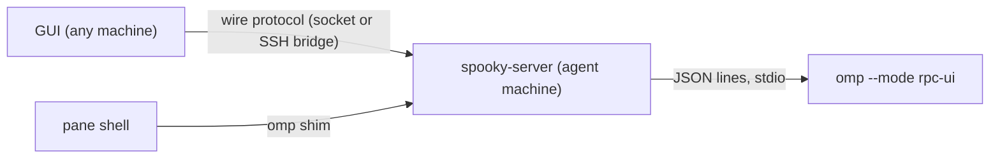

# Agent interface (oh-my-pi)

Status: **phases 1 to 5 implemented** for the `omp` backend (server-owned agent, Markdown, tool cards, reasoning, dialogs, model and thinking selection, restore after a server restart, arguments, bash/zsh/fish shim); other backends are design. The feasibility probe and the phase 1 evidence are below.

A built-in feature that gives Spooky its own interface for [oh-my-pi](https://github.com/can1357/oh-my-pi) (`omp`) instead of its terminal UI: a conversation view with streaming text, tool cards, a composer, and dialogs, drawn natively. It is a first-party feature (`features/agent/`), not a mod: a conversation with markdown and diffs is richer than the declarative UI tree planned for mods ([mods](mods.md), phase 4). It may be exposed to mods later.

## Requirements

1. **Inside and outside the terminal.** An agent can be opened from the GUI (a button and a command-palette entry) without any shell. Typing plain `omp` in a Spooky terminal pane also opens the agent interface, without the user typing `--mode rpc` or anything else.
2. **Remote.** Connected to another machine's Spooky server, the agent runs on that machine, in its directories, with its credentials and tools, and the GUI draws it. Nothing runs on the GUI's machine.
3. **Persistence like a shell.** Closing or losing the GUI does not stop an agent mid-task; reconnecting shows the conversation.
4. Falls back to the normal `omp` terminal UI whenever the interface cannot be offered.

## Why the server owns the agent

Spooky's rule is that sessions live on the server and a UI disconnect is not process termination. An agent follows it: `spooky-server` spawns `omp --mode rpc-ui` (no PTY needed: the protocol is JSON lines on stdio), keeps the conversation state, and serves it to any attached client over the existing wire protocol, local socket or SSH bridge. That one decision gives requirements 2 and 3 together. The GUI never talks to `omp` directly.

## Backends: omp, Claude Code, Codex

The interface is not specific to `omp`. A **backend** is one agent program and its line protocol; the rest (the child process, the bounded conversation, the pane snapshot, the GUI) is shared and knows no program by name. In `spooky-server`, `agent/mod.rs` defines the `Backend` trait and the normalized `Event` (`TurnStarted`, `TurnEnded`, `User`, `AssistantStarted`, `AssistantDelta`, `AssistantDone`, `Tool`, `Failure`); `agent/omp.rs` is the first backend. A backend supplies the command line, the lines sent at start, the translation of each frame into events (and any lines to send back, for protocols that need replies), and the lines that send a prompt and abort. `CreateAgent` names the backend; an unknown name is refused with the list of available ones. Each backend owns its own settings and install hint; none is assumed to be installed.

| Backend | Program | Protocol it would use | State |
| --- | --- | --- | --- |
| `omp` | `omp --mode rpc-ui` | omp's JSON-line RPC | implemented |
| Claude Code | `claude` | `--input-format stream-json --output-format stream-json` JSON lines, or an ACP adapter | not started; not probed here |
| Codex | `codex` | `codex app-server` JSON-RPC lines, or an ACP adapter | not started; not probed here |

The two unverified rows are intentions, not facts: their protocols have not been run in this repository. The ACP route (Agent Client Protocol, JSON-RPC over stdio) is the common denominator several agents speak; a single ACP backend would cover any of them, at the cost of exposing only what ACP standardizes. Richer, program-specific features (omp's session tree, queue) stay behind per-backend capabilities in later phases: the GUI offers a control only when the backend reports the capability, so a backend never has to fake one.

## Entry points

**From the GUI (outside the terminal).** `New agent` (header button, palette command `core.agent.new`) asks the server to create an *agent pane*: a pane in the layout whose content is an agent instead of a terminal. It takes a working directory like a new workspace does. No shell is involved.

**From a terminal pane (inside).** The server prepares, for the shells it spawns, a directory with an `omp` shim earlier in `PATH`, and sets `SPOOKY_PANE`. The shim is written by that machine's own server: nothing is uploaded, and a remote needs only an updated `spooky-server`. The shim:

1. runs the real `omp` unchanged (exec) unless the launch is interactive: no `-p/--print`, no subcommand (`omp models`, `omp commit`…), stdin and stdout are a terminal, and `SPOOKY_PANE` is set;
2. otherwise asks the server to open an agent in that pane with the launch flags it was given (`--model`, `--continue`, `@files`, a prompt…);
3. if the server answers that no attached client can draw agents (an older GUI, or none), execs the real `omp`. The user sees what they always saw;
4. otherwise waits. The pane shows the agent view; Ctrl+C in the shell sends `abort`; closing the agent returns the shell prompt.

**As built (phase 4, partly).** The shim is a script in `<state dir>/shim/omp`, written by the server at start. Shells get `SPOOKY_PANE`, `SPOOKY_SHIM_DIR` and the shim directory first on `PATH`; because profiles usually put their own directories first, zsh is started with a `ZDOTDIR` whose `.zshenv` restores the user's, runs their `.zshenv` and moves the shim to the front before the first prompt, and bash does the same through `PROMPT_COMMAND`, and fish through a `vendor_conf.d` snippet found via `XDG_DATA_DIRS` that moves the shim to the front at the first prompt. Other shells only get the `PATH` entry. `omp` at a terminal runs `spooky-server agent-open omp -- <arguments>`, which sends `OpenAgent { pane, backend, cwd, args }`: the server starts the agent with the same pane id as the shell: the snapshot shows the agent where the terminal was and hides the terminal, which keeps running and shows again, whole screen included, when the pane is closed (`ClosePane` on a pane with an agent closes only the agent; a second one closes the shell). Closing the tab or workspace ends both. The saved state marks such an agent (`covers`) so a restarted server starts a new shell under it. The GUI focuses the agent. The server accepts `--model`, `--thinking`, `--approval-mode`, `--resume` (each with a value), `-c`/`--continue`, `--no-session`, `--auto-approve` and at most one prompt that contains a space (a single word is a subcommand such as `commit`); with anything else (`-p`, `--help`, subcommands), a non-terminal stdin or stdout, no `SPOOKY_PANE`, or any failure, the shim runs the next `omp` on `PATH`. The setting `agent_shim` in `server.toml` is **on by default** (a change from the first design, which had it off), because the point is that typing `omp` does what the user expects; `false` disables it. Not done: there is no client capability check (the tab simply exists for whoever attaches next), and Ctrl+C does not abort.

## Protocol (v10)

Implemented in phase 1, all bounded like the rest:

- `CreateAgent { workspace, backend }` starts a tab whose only pane is an agent, in the workspace's directory. `AgentPrompt { pane, text }` (at most 256 KiB; queued after the current turn while the agent works) and `AgentAbort { pane }` act on it. `OpenAgent { pane, backend, cwd, args }` (at most 16 arguments of 8 KiB; the backend accepts a closed set and refuses the rest) does the same next to an existing pane, in a given directory; the `omp` shim sends it. Closing the pane, tab or workspace ends the agent's process group.
- An agent pane is an ordinary pane of the snapshot: `Pane::agent` is `Some(Agent { backend, busy, ended, dropped, messages })`, with `AgentRole::{User, Assistant, Thinking, Tool, Notice}` entries (a tool entry carries name, detail, state and bounded output), the open `dialogs`, the `model`, `thinking`, the choices of both, the context percentage the `usage` its providers report once `AgentUsage { pane }` asked (refused while a turn runs; for `omp` the server sends its `/usage` command and parses the text of the answer into providers, notes and allowances with the percent left and the time to renewal; the answer is a report, never a message of the conversation) and the `roles` the program's own configuration gives its models (for `omp`, the `modelRoles` block of `~/.omp/agent/config.yml`, or of `$PI_CODING_AGENT_DIR`; its protocol does not report them, so the server reads that one block of plain `role: provider/id[:level]` lines, at most 256 KiB and 32 roles, once when the agent starts). The existing revision and long-poll machinery delivers changes, so every client sees the same conversation. Terminal requests on an agent pane, and agent requests on a terminal, are refused by name.
- The conversation is bounded: 200 entries, 128 KiB in total, 32 KiB per entry (an overlong entry is cut and marked). The whole bounded conversation is resent when it changes. `AgentSetModel`, `AgentSetThinking` (only values the agent listed) and `AgentAnswer { pane, dialog, answer }` (validated against the open dialog) are the only ways a client changes the agent; a dialog is never answered by the server on its own.
- `ServerStatus` counts live agents, and `spooky-server stop` refuses while agents run, as for shells.
- The server ignores frames over 1 MiB and sets an event filter so `omp` sends only the events the client needs, as text deltas.

Planned: `AgentEvents` with a cursor and deltas, a closed `AgentCommand` set (model, thinking level, compaction, fork), `AgentDialog` for questions and approvals, and a client capability announced on connect so the shim can fall back.

## Persistence and restart

`omp` persists its own sessions. An agent tab is saved in `workspaces.json` with its backend, directory and the session file `omp` reported (`get_state`), and a restarted server starts it again with `--resume=<file>` and loads the history with `get_messages_page`; a session file that is gone starts an empty conversation. A running turn is lost with the process, as a running shell command is. A saved session whose file does not exist (`omp` writes it with the first message) is not resumed: the agent starts empty.

## The shim and shells that move PATH

The shim directory is put first on `PATH` and, for zsh and fish, checked again just before every command, because tools such as mise rebuild `PATH` at every prompt. The hooks of all three shells are always set up, whatever `$SHELL` is: over SSH `$SHELL` is the login shell (bash), and a profile may start another (`exec fish`), which reads only its own variable.

## Finding the program

A server started over SSH (`ssh host spooky-server bridge`) has the non-interactive `PATH`, which usually lacks the directories user tools are installed in, although the panes' shells find them. The backend's program (`SPOOKY_OMP` or `omp`) is looked for in the `PATH` and then in `~/.local/bin`, `~/.bun/bin`, `~/.cargo/bin`, `~/.local/share/mise/shims`, `/opt/homebrew/bin` and `/usr/local/bin`; those that exist are appended to the agent's `PATH` so the tools it starts are found too (`crates/spooky-server/src/agent/path.rs`). A program installed anywhere else needs `SPOOKY_OMP` or a place on the `PATH`.

## Security

- Model output, tool output and file contents are untrusted data: drawn as text and markdown, never executed. Links follow the existing policy (`http`, `https`, `mailto`, target shown before opening).
- Tool approvals (`approval-mode`, `ask`) are decided by the user in the GUI. The server forwards the request and the answer; it never answers one itself.
- A prompt is sent only on a user action (the composer, a button). Output never causes a prompt: the repository rule that output does not cause a command to run holds here too.
- The GUI holds no model credentials. `omp` uses the ones on the machine it runs on; a remote needs `omp` installed and logged in there.
- The `omp` child is started by the server of the same user, with that user's permissions, bounded in frame size (1 MiB per frame, `omp` chunks larger ones with protocol 2), event backlog and queue depth. A slow or absent GUI never stalls the child: the log is bounded and the oldest events are dropped from the cache, not from `omp`'s own transcript.

## What is reimplemented

The TUI's pickers and slash commands become native views over RPC commands that exist: model and thinking selection (`get_available_models`, `set_model`, `get_available_thinking_levels`), the session tree (`get_tree`, `navigate_tree`, `fork`), queue chips (`queue_update`, `remove_queued_message`), compaction, todo phases, the slash-command list (`get_available_commands`). Anything without an RPC equivalent stays out until it has one; the user can still open the normal TUI in a terminal pane.

## Feasibility probe

On the development machine (`omp` 18.18.6): `omp --mode rpc --no-session` printed its `ready` frame (protocol 1, supports 2) and answered `get_state` and `get_available_commands` without a model call. One real prompt ("Reply with exactly the word: pong") streamed `agent_start`, `turn_start`, `message_update` text start/delta/end, `turn_end`, `agent_end`, `prompt_result` and `session_settled` in 19 frames; the first text delta arrived 2.8 s after the prompt and the turn finished in 3.2 s. The largest frame was 60 KB (state and command metadata), far under the 1 MiB limit.

## Phases

Each phase is usable and verified on its own, with a real `omp`, an isolated server and a real PTY.

1. **Server-owned agent, text only — implemented.** `CreateAgent`, `AgentPrompt`, `AgentAbort`, the agent pane with the streamed answer and a one-line composer, the `Backend` seam. Local only.
2. **Conversation view.** Messages as markdown, thinking blocks, tool cards (read, edit with a diff, bash output), the footer (model, context, cost), queue chips.
3. **Dialogs and controls.** `ask` and selection dialogs, model and thinking pickers, compaction, todo list, session tree and fork.
4. **Terminal entry — partly implemented.** The shim and its fallbacks for zsh and bash. Missing: forwarding launch flags, the client capability, and fish.
5. **Remote and persistence.** Agent panes over the SSH bridge, saved layout with the session id, restart.

## Acceptance evidence

- An agent opened from the GUI and one opened by typing `omp` in a pane both show a real streamed answer; closing and reopening the GUI mid-turn shows the conversation and the turn finishing.
- Against an isolated loopback sshd with its own `spooky-server` and `omp`, the same agent runs on the remote machine and the GUI shows it; nothing runs locally.
- `omp -p "…"`, `omp models`, a non-terminal stdin, an older GUI and a server without the setting all reach the real `omp` unchanged.
- A killed `omp`, a malformed or oversize frame, and a GUI that stops reading leave terminals, other agents and the server working, and the agent pane reports the failure.
- A tool approval is answered only by a user action; a restart restores an agent pane with its conversation.

## Web view

On macOS an agent pane that fills its tab is shown by a web page (React, `web/agent`) in a `WKWebView`, which gives the conversation the typography, shadows and menus the iced widgets do not; the native view remains for splits and other platforms. See `docs/architecture.md` (*Agent web view*) for the ownership and the security rules: the page draws untrusted text without raw HTML or images, cannot fetch or navigate, and can only post validated actions that become the same requests the native composer sends.

The model list searches without autocorrect or autocapitalization and orders each provider's models newest first. The program reports no release dates, so the order comes from the names: the first run of version numbers in the id (`5.6`, `4-5`), then a `YYYYMMDD` stamp, then the name (`web/agent/src/features/models/models.ts`).

## Look

The reference is a chat app: the user's message in a rounded bubble on the right; the agent's answer as plain text in a centred column about 760 px wide, in the system's proportional font (the conversation is prose, unlike the terminal), with a row of actions underneath; a rounded composer pinned to the bottom with the agent's name and state beneath it. Only actions that exist are drawn: today **Copy**. Regenerate, speech and rating controls are not drawn because nothing implements them.

## Phase 1 evidence

See the agent bullet under *Verified* in the README: real `omp` through the GUI (streaming, Stop, GUI relaunch showing the same conversation, no process left after `stop --force`), and server tests against a scripted agent. Known limits (phase 1 evidence; phases 2 to 5 are under *Verified* in the README): the whole bounded conversation is resent on each change, `ready` is not negotiated, and the backend is fixed to `omp` in the GUI.

## Open decisions

- **RPC or ACP.** Backends sit behind one trait. `omp` uses its RPC because it exposes the most of `omp`; ACP is the standard route for Claude Code, Codex and others and would be one more backend. Which to build second is open and needs a probe of each program's protocol first.
- **Rich rendering.** iced's markdown widget and syntax highlighting cover text and code; a diff view and images need first-party code. Measure before promising full parity with the TUI.
- **Maintenance.** The RPC protocol is `omp`'s own and changes with it. Phase 1 does not read `omp`'s `ready` frame; it should negotiate the version there and refuse one it does not speak, as the session protocol does.
