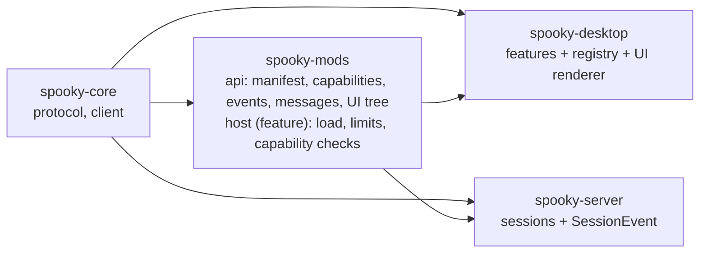

# Mods

Status: **design, not implemented.** Nothing in this document exists in the code yet. Phases 0 to 2 below are internal refactors that do not depend on the open runtime decision; phase 3 onwards does.

A *mod* is a user-installed extension of Spooky: a directory with a manifest and a program. Mods add commands, status items, settings sections, panels and reactions to session events. Spooky's own features are meant to be built on the same registry, so a mod is never a second-class citizen.

## Goals and non-goals

Goals:

- One registry of commands that buttons, menus, keyboard shortcuts, the command palette and mods all use.
- Built-in features and mods contribute through the same extension points.
- A crashing or hung mod never stops a terminal session or blocks the GUI thread.
- Everything a mod can do is declared, granted by the user and enforced by the host API.

Non-goals:

- Replacing the terminal renderer, the wire protocol or the emulator.
- Transforming the PTY byte stream in line (latency, and it would make output able to cause commands).
- A marketplace, automatic downloads or automatic updates. Mods are installed by hand from a local directory.
- Dynamic libraries: loading one needs first-party `unsafe`, which is forbidden.
- A `dyn Mod` trait. A mod is data (a manifest) plus something that runs; built-in features are ordinary static modules.

## Trust model

A mod is trusted code the user chose to install, like a shell script. Capabilities limit what the *host API* will do for it; they are not an operating-system sandbox. A mod running as a separate process, or a script that is given a function that spawns processes, can do whatever the user can unless that function is withheld. Documentation and the permission prompt must say so.

Rules that hold whichever runtime is chosen:

- Discovering a mod executes nothing. A mod runs only after the user enables it.
- A manifest path (`entry`, `run`) is relative, contains no `..`, and is not a symlink leaving the mod directory.
- Capabilities are denied by default, granted per mod, stored outside the mod directory, and checked on every host call.
- Terminal output, titles and clipboard text handed to a mod are untrusted data.
- **Gesture rule.** A mod may write to a pane's input (`pane.input.write`) only while handling a user action (a command, shortcut or click). Writing in reaction to output or an event needs the separate `pane.input.autonomous` capability. A mod holding both `pane.output.read` and `pane.input.autonomous` needs an explicit confirmation when enabled. This keeps the repository rule that output never causes a command to run.
- Nothing is uploaded to a remote host without the user's authorization. A mod that runs on a server must be installed there by hand.
- Resource bounds: message size, queue depth, call rate, per-call time and memory, UI tree depth and node count. A mod that exceeds them is stopped, not waited for.

## Architecture



Everything mod-related lives in one crate, `spooky-mods`, with internal modules `manifest`, `capability`, `event`, `ui` (the declarative tree), `message` (host to mod protocol) and, behind the `host` Cargo feature, `host`. It depends on `spooky-core` (pane, tab and workspace ids in events) and on neither iced nor the terminal emulator, so the server can use the types without the GUI stack, and compiles the host (process or script supervision) only when it runs mods. Drawing the UI tree is `spooky-desktop`'s job. If an SDK for mod authors is ever published, the `manifest`, `capability`, `event`, `ui` and `message` modules are the part to extract.

### Internal modularization (the larger part of the work)

At the time of writing `spooky-desktop/src/main.rs` has about 2,500 lines, 75 `Message` variants and 51 `App` fields, and `spooky-server/src/main.rs` keeps everything inside one `unix` module. Before mods exist:

- **Desktop:** each feature (search, links, settings, uploads and capture, connection with SSH and Tailscale, window and dropdown, clipboard) gets its own state, message type, `update`, `view` and `subscription`. `App` composes them with nested messages.
- **Server:** the `unix` module is split into state (workspace tree), pane (PTY and emulation), render (snapshots), handler (protocol), persist and log.
- **Commands:** every action a button or shortcut performs becomes a `Command` (`{id, title, args}`, ids namespaced such as `core.tab.new` or `<mod-id>.<name>`). `shortcuts::Shortcut` becomes a key-to-command-id table. A command palette lists them.
- **Events:** a desktop `AppEvent` and a server `SessionEvent` bus. Today the server knows a pane's title and exit; it does not know the working directory or when a command ends (those need OSC 7 and OSC 133).
- **Contributions:** menus, status items and settings sections are registered rather than hard-coded. The Tailscale picker becomes the first target provider.

### Extension points

| Extension point | Allows | Capability | Runs in |
|---|---|---|---|
| Commands | palette, shortcut and menu entries | implied by the manifest | GUI |
| Status items | text or icon in the footer | `status.write` | GUI |
| Settings section | typed schema drawn by the settings page, stored under `[mods.<id>]` in `config.toml` | implied | GUI |
| Panels | a page or sidebar section described as a declarative UI tree | `ui.panel` | GUI |
| Session events | workspace, tab and pane lifecycle, title, process exit | `events.session` | GUI |
| Output observation | patterns over pane output (untrusted) | `pane.output.read` | server |
| Pane input | send bytes to a pane | `pane.input.write`, gesture rule | GUI, through `Request::Input` |
| Layout | create tab, split or workspace | `layout.edit` | GUI |
| Link providers | text pattern to action | `links.provide` | GUI |
| Target providers | list machines | `targets.provide` | GUI |
| Host effects | notification, clipboard write, open URL (scheme allowlist as for links) | `notify`, `clipboard.write`, `url.open` | GUI |

Mod UI is a declarative tree (text, list, button, input, table) drawn by the host with its own styling. A mod never touches iced.

### Manifest

`$XDG_CONFIG_HOME/spooky/mods/<id>/mod.toml`. Commands and settings are declared so the host can show them without starting the mod (lazy activation).

```toml
id = "git-status"            # lowercase letters, digits, '.', '-', '_'; namespace for commands, storage, permissions
version = "0.1.0"
api = 1                      # mod API version, independent of the session protocol version
entry = "main.js"            # or run = ["./git-status"] for an external process; see Runtime
activation = ["on_command", "on_event:pane.title"]
capabilities = ["events.session", "status.write"]

[[commands]]
id = "git-status.refresh"
title = "Git: refresh"

[[settings]]
key = "interval_s"
type = "int"
min = 2
max = 300
default = 10
```

The mod API is versioned on its own. There is no compatibility mode: a host refuses a mod whose `api` it does not speak.

## Runtime (open decision)

The host API and capability set above are the contract. How a mod executes is replaceable behind it. Two candidates:

| | External process, JSON lines over stdio | Embedded QuickJS (`rquickjs`) |
|---|---|---|
| Startup | process spawn | microseconds |
| Failure isolation | a crash or hang cannot touch the GUI | a runaway script shares the process; bounded with an interrupt handler and a memory limit |
| Languages | any | JavaScript |
| Hot reload | restart the process | drop and recreate the runtime |
| Server-side and remote | natural (the server spawns it) | needs the runtime inside `spooky-server` |
| Cost | process supervision, restart with backoff, crash-loop breaker | a C dependency (vendored; the `unsafe` stays in the third-party crate) |

Herdr, a similar application, runs mods as embedded QuickJS scripts and builds its own interface from them. Recommendation until measured: external process for robustness. Decide after a prototype that loads one mod, registers one command and measures binary size, startup time and the behaviour of an infinite loop. Do not implement the second runtime speculatively.

## Phases

Each phase ships and is verified on its own.

0. **Refactor only.** Split desktop and server into modules, one feature at a time, following the layout in [architecture](architecture.md#source-layout). No behaviour change; all gates and a run of the real application. Progress: `spooky-server` and `spooky-core`'s client are split into modules (the protocol and PTY tests pass unchanged); in the desktop the pure helpers moved to `terminal/`, `ui/`, `platform/`, `tabs` and `layout`, the `settings`, `window`, `tailscale`, `hyperlinks`, `splits`, `search` and `attachments` features are folders under `features/`, and `App` lives in `app/`, one file per concern. Left as is on purpose: workspaces/tabs and the connection stay in `app/` because they share the snapshot, selection and focus state with everything else; they become features when the command registry (phase 1) gives them a seam. Phase 0 is complete.
   Follow-up: the connection state (target, generation, channel state, unreachable reason) is now `features/connection`, with tests. Workspaces and tabs remain in `app/workspaces.rs`.
1. **Command registry and palette.** Shortcuts become key-to-command. Built-in features use it.
   Progress: `commands.rs` holds the command registry (stable `core.*` ids and titles); `shortcuts` maps chords to commands; shortcuts, the header buttons and the "…" and right-click menus that act on the selection, and the command palette (`features/palette/`, Cmd+Shift+P) all send `Message::Run(command)`, handled by `run_command` in `app/input.rs`. Controls that target a specific item (a pane's quick actions, a tab's or workspace's own menu) keep sending their targeted messages. Commands are a closed enum for now; a mod-provided command variant is added with the host in phase 3.
2. **Event bus and contribution registry.** Menus, status items and settings sections registered by built-in features.
3. **The `spooky-mods` crate** (api modules plus the `host` feature) used on the GUI side, with the chosen runtime, an example mod in the repository, and `spooky mod check` (loads the mod, runs its initialization once, exits nonzero with the exact error).
4. **Declarative UI** (panels, status items) and settings by schema.
5. **Server-side host:** session events and output observation, with the gesture rule.
6. **Optional WASM runtime** behind the same API, only if a real sandbox becomes a requirement.

Phases 3 onwards should be driven by concrete mods, not speculation: the API is the union of what three or four real mods need.

## Acceptance evidence

Run against real child processes or scripts, with isolated directories:

- A mod that crashes, hangs, exceeds a size or rate limit, or sends malformed or oversize messages leaves sessions and the GUI working; the mod is reported and restarted or stopped by policy.
- A call without the granted capability is refused and reported; a granted one works.
- Disabling a mod stops it; quitting leaves no mod process behind.
- A manifest whose entry escapes the mod directory (`..`, absolute path, symlink) is refused.
- The gesture rule: a mod cannot write to a pane from an event handler without `pane.input.autonomous`.
- A broken save of a mod keeps the previous version running and shows the error.
- Settings declared by a mod appear in the settings page, are validated against their schema and are written to `config.toml`.
